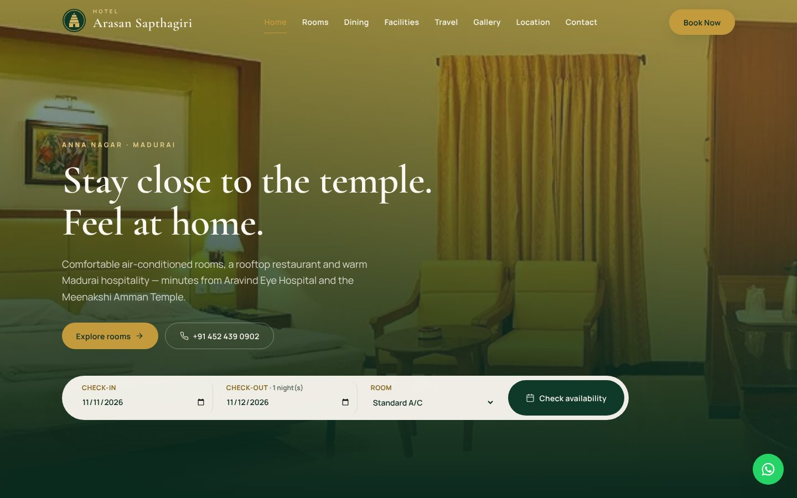
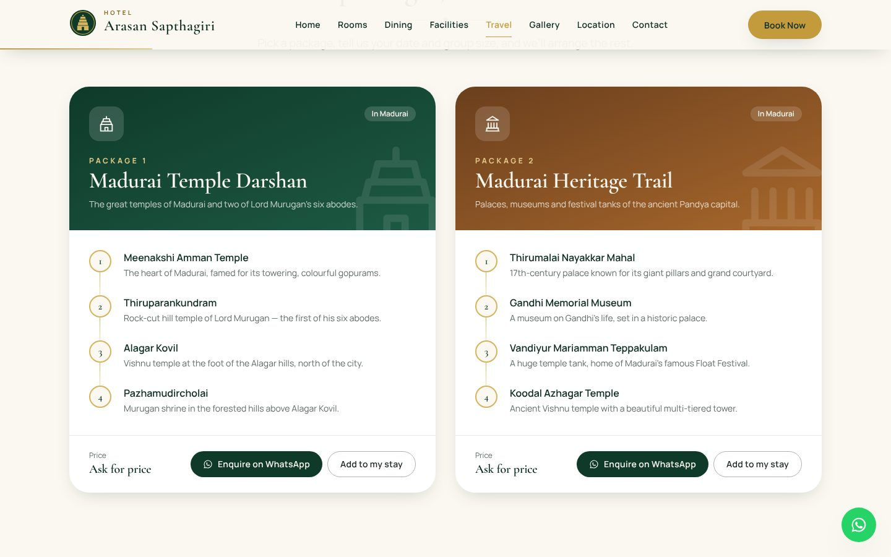
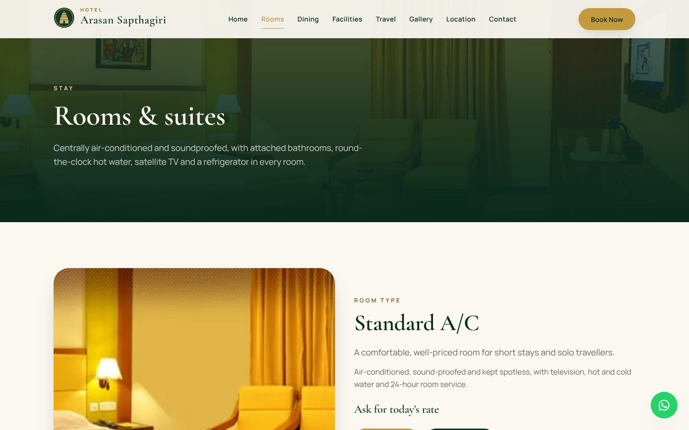
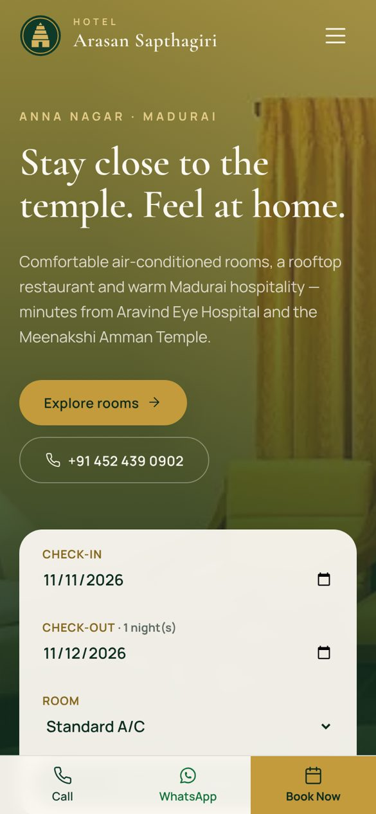

# Hotel Arasan Sapthagiri — website

A modern, mobile-first website for **Hotel Arasan Sapthagiri**, a 31-room hotel in Anna Nagar, Madurai — rebuilt from the hotel's original site with a "temple-town luxury" look, direct booking enquiries over WhatsApp, and travel packages.



| Travel packages | Rooms | Phone |
| --- | --- | --- |
|  |  |  |

## Highlights

- **Angular 20** — standalone components, signals, zoneless change detection, new control flow, lazy-loaded routes.
- **Static site generation** — all 11 pages are prerendered to HTML at build time, so they load fast, work without JavaScript for crawlers, and host anywhere as static files.
- **Tailwind CSS 4** design system — tokens in `@theme`, custom utilities, self-hosted fonts (no third-party requests).
- **Booking enquiries without a backend** — a validated form opens WhatsApp with the request pre-written and (optionally) emails the hotel through [Web3Forms](https://web3forms.com).
- **Travel packages** — four sightseeing trips of four sites each, which can be added to a room request.
- **SEO** — per-page titles, descriptions, canonical URLs, Open Graph / Twitter cards, `schema.org` JSON-LD (`Hotel`, `BreadcrumbList`, `TouristTrip`), generated `sitemap.xml` and `robots.txt`.
- **Accessibility** — 0 axe-core violations (WCAG 2.2 AA) on every page at desktop and phone sizes, keyboard-friendly lightbox built on `<dialog>`, skip link, reduced-motion support.
- **Motion** — scroll-reveal animations, page-to-page View Transitions, a scroll progress line and an "Up next" card that leads from each page to the next.
- **i18n ready** — English and a complete Tamil translation (Tamil is switched off for now; see below).
- **Tested** — Jasmine/Karma unit and component tests, plus a GitHub Actions workflow that tests, builds and checks the prerendered output.

Lighthouse (mobile, compressed): Performance ~89 · Accessibility 100 · Best Practices 100 · SEO 100.

## Pages

| Route | Page |
| --- | --- |
| `/` | Home — hero with availability check, rooms, dining, facilities, gallery, location |
| `/about` | Story, reasons to stay, key figures |
| `/rooms` | Four room types with enquiry and WhatsApp buttons |
| `/dining` | Rooftop and multi-cuisine restaurants |
| `/facilities` | All facilities, conference hall, travel desk |
| `/travel` | Four travel packages × four sites |
| `/gallery` | Filterable photo gallery with a full-screen viewer |
| `/location` | Map, directions and travel times |
| `/contact` | Contact options and message form |
| `/book` | Booking request (accepts `?in=YYYY-MM-DD&out=YYYY-MM-DD&room=<id>&package=<id>`) |

## Getting started

Requires **Node.js 20.19+** (22 recommended).

```bash
npm install
npm start           # http://localhost:4200
npm run build       # static site in dist/arasan-sapthagiri/browser
npm test            # unit tests (watch mode, opens Chrome)
npm run test:ci     # unit tests once, headless
```

`npm run build` runs `scripts/prebuild.mjs` first (site URL, `sitemap.xml`, `robots.txt`) and `scripts/postbuild.mjs` after (publishes the prerendered 404 page as `404.html`).

## Before going live

Everything hotel-specific lives in **`src/app/core/hotel.config.ts`**:

| Setting | What to put there |
| --- | --- |
| `HOTEL.whatsapp` | The hotel's WhatsApp number, digits only with country code (e.g. `919876543210`). Currently a placeholder. |
| `HOTEL.web3formsKey` | A free access key from [web3forms.com](https://web3forms.com) so enquiries are also emailed. Until it is set, enquiries go by WhatsApp only. |
| `ROOM_TYPES[].rate` | Nightly rates (number, INR). `null` shows "Ask for today's rate". |
| `TRAVEL_PACKAGES` | Package sites — confirm with the hotel's travel desk. Prices are intentionally not shown. |

Photos are in `public/images` (WebP). The originals from the old site are low resolution; new photography will make the biggest visual difference.

## Deploying to Vercel

1. Push this repository to GitHub.
2. In Vercel, **Add New → Project**, import the repository. `vercel.json` already sets the install/build commands, the output folder, clean URLs, caching and security headers — no framework preset or settings needed.
3. Deploy. The canonical URLs, sitemap and structured data automatically use the Vercel production domain.
4. When a custom domain is connected, add an environment variable **`SITE_URL`** (e.g. `https://hotelarasansapthagiri.com`) and redeploy.

## Turning Tamil back on

All text is in `src/i18n/en.json` and `src/i18n/ta.json` (kept in sync by a unit test). To show the language button again, add `'ta'` to `ENABLED_LANGS` in `src/app/core/i18n.ts`.

## Project structure

```
src/
  app/
    core/        hotel data, SEO + JSON-LD, i18n, enquiry (WhatsApp/email), scroll-reveal
    layout/      header, footer, quick-contact bar, "Up next" card, route progress bar
    shared/      UI pieces (icons, page hero, lightbox, CTA band), booking bar, form validators
    features/    one folder per page
  i18n/          en.json, ta.json
scripts/         prebuild (site URL, sitemap, robots) and postbuild (404.html)
public/images/   photos and icons
```
